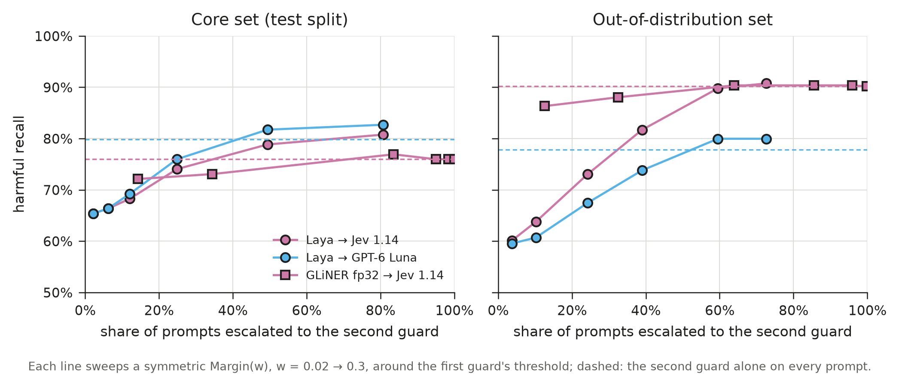

# 11 · Ensembles and cascades, simulated offline

**Date:** 2026-10-16 · **Guards:** `EnsembleGuard`, `CascadeGuard` (`reflexguard.rules`) · **Script:**
`scripts/compose_eval.py` · **Full tables:** [`11-tables.md`](11-tables.md) · **Figure:**
`data/eval/figures/paper_cascades.{pdf,png}`

## Question

Do guards made of guards beat their best member? Two questions:

1. **Ensembles** (all members run, a rule combines their votes): do they cut false positives?
2. **Cascades** (a cheap guard answers first and hands uncertain prompts to a stronger one): how much of the strong
   guard's accuracy do we keep, and how much traffic still reaches it?

## Setup

- No model is called. Every member's per-prompt, per-category scores come from the eval caches
  (`data/eval/**/cache/<model>.jsonl`), and the composites are recomputed exactly as reflexguard's code does.
- Each model uses one config, picked by best balanced accuracy on the core dev split, at its dev threshold:
  Laya `noul&choice` @ 0.268, GLiNER fp32 `score` @ 0.505, Jev 1.14 `score` @ 0.303, GPT-6 Luna `score` @ 0.197.
  Results are on core test and on the OOD set; thresholds and margins are not tuned on either.
- Ensembles: `Votes(k)` per category over members' decisions (`AnyOf` = k 1, `AllOf` = k n). Latency is the slowest
  member, since members run concurrently.
- Cascades: `Margin(below, above)` escalates when the first guard's top score is in `[t − below, t + above)`, t
  being that guard's own threshold. Latency adds the second guard's when escalated. "Escalated" is the share of
  prompts that left the first guard.
- An earlier version escalated on an absolute band (`uncertain=(lo, hi)`, any category). It sent 100% of GLiNER's
  prompts on, because its scores cluster mid-range, and Laya → Jev lost recall: that band was the wrong tool and is
  replaced by `Margin`.

## Results

### Single models

| guard | core recall | benign FP | hard-neg FP | OOD recall | OOD benign FP | OOD hard-neg FP |
|---|---|---|---|---|---|---|
| Laya | 65.4% | 6.4% | 12.9% | 59.2% | 35.4% | 31.1% |
| GLiNER fp32 | 72.1% | 11.7% | 18.5% | 83.4% | 42.4% | 55.1% |
| Jev 1.14 | 76.0% | 1.1% | 8.1% | 90.2% | 24.2% | 49.5% |
| GPT-6 Luna | 79.8% | 2.1% | 8.1% | 77.8% | 15.2% | 25.7% |

### Ensembles: fewer false positives, at a recall cost

| guard | core recall | benign FP | hard-neg FP | OOD recall | OOD benign FP | OOD hard-neg FP |
|---|---|---|---|---|---|---|
| Jev \| GPT-6 Luna | 82.7% | 3.2% | 12.9% | 91.1% | 27.3% | 51.9% |
| Jev & GPT-6 Luna | 72.1% | **0.0%** | 3.2% | 76.5% | 11.1% | **22.7%** |
| **Votes(2): Laya, Jev, GPT-6 Luna** | 77.9% | 1.1% | 3.2% | 79.6% | 13.1% | 32.7% |
| Votes(3): all four | 64.4% | 1.1% | 2.4% | 71.5% | 12.1% | 22.4% |
| Laya \| GLiNER (local only) | 82.7% | 14.9% | 26.6% | 86.9% | 58.6% | 64.6% |

- **`Votes(2)` over Laya, Jev and GPT-6 Luna** keeps Jev's core recall (77.9% vs 76.0%), cuts its core
  hard-negative FP from 8.1% to 3.2%, and halves its OOD over-blocking (benign 24.2% → 13.1%, hard-neg 49.5% → 32.7%).
- `AllOf` of the two API models is the precision end: no core benign FP, the lowest OOD FP, ~4 points of core recall
  lost. `AnyOf` is the recall end and over-blocks more than either member.
- Local models alone don't make a good ensemble: `Laya | GLiNER` reaches 82.7% recall but flags 15–60% of benign text.

### Lazy ensembles: the same verdicts, fewer calls

`EnsembleGuard(..., lazy=True)` runs members in order and stops once the rule's verdict is settled for every
category. Its verdicts equal the eager ensemble's on every prompt; only the calls and latency change. Members are
ordered local first, so "API calls" is the share of prompts that reached an API member.

| ensemble | core recall | benign FP | hard-neg FP | OOD recall | OOD benign FP | API calls (core / OOD) |
|---|---|---|---|---|---|---|
| `Votes(2)`: Laya, GLiNER, GPT-6 Luna | 69.2% | 2.1% | 6.5% | 73.8% | 20.2% | 39% / 68% |
| `Votes(2)`: Laya, GLiNER, Jev | 67.3% | 3.2% | 9.7% | 79.0% | 23.2% | 39% / 68% |
| `(Laya \| GLiNER) & Jev & GPT-6 Luna` | 61.5% | **0.0%** | **2.4%** | 69.4% | **10.1%** | 41% / 76% |

- Lazy `Votes(2)` calls the API only when the two local models split on some category; with 8 categories that is
  39% of core prompts. Calling it only when they split on the overall verdict (harmful or not) would be 21% / 36%,
  at 73.1% core recall, but that is a different composition: built-in rules vote per category.
- The lazy AND is the precision end: no core benign false positives, with 59% fewer API calls on core and 24% fewer on OOD.
- Lazy latency adds up (median 676 ms vs 464 ms eager here); lazy trades latency for cost.

### Cascades: most of the API model's accuracy for half the calls

| cascade | core recall | benign FP | hard-neg FP | OOD recall | OOD benign FP | escalated (core / OOD) |
|---|---|---|---|---|---|---|
| Laya → Jev, `Margin(0.1)` | 68.3% | 3.2% | 11.3% | 73.0% | 32.3% | 12% / 24% |
| Laya → Jev, `Margin(0.2)` | 78.8% | 3.2% | 14.5% | 89.8% | 35.4% | 49% / 60% |
| Laya → Jev, `Margin(0.2, 0.05)` | 81.7% | 6.4% | 16.9% | 90.4% | 42.4% | 46% / 50% |
| Laya → GPT-6 Luna, `Margin(0.2)` | 81.7% | 4.3% | 12.1% | 80.0% | 27.3% | 49% / 60% |
| Laya → GPT-6 Luna, `Margin(0.2, 0.05)` | 83.7% | 6.4% | 14.5% | 81.5% | 36.4% | 46% / 50% |
| GLiNER → Jev, `Margin(0.05)` | 73.1% | 2.1% | 10.5% | 88.1% | 36.4% | 34% / 32% |
| GLiNER → Jev, `Margin(0.1, 0.02)` | 81.7% | 6.4% | 14.5% | 94.2% | 43.4% | 69% / 33% |
| GLiNER → Laya → Jev, `[Margin(0.05), Margin(0.2)]` | 76.0% | 3.2% | 13.7% | 87.9% | 39.4% | 34% / 32% left GLiNER |

- **Laya → Jev at `Margin(0.2)`** matches or beats Jev's recall on both sets (78.8% vs 76.0% core, 89.8% vs 90.2%
  OOD) while about half the prompts reach the API. Laya → GPT-6 Luna at the same margin does the same against GPT-6
  Luna (81.7% vs 79.8%; OOD 80.0% vs 77.8%).
- **The cost is false positives on the text the first guard keeps.** A confident Laya flag stands without a second
  opinion, so core hard-neg FP rises from 8.1% to 12–15% and OOD benign FP to Laya's level (~35%) instead of Jev's.
- **Asymmetric margins move along that trade-off.** Wider below the threshold (`Margin(0.2, 0.05)`) re-checks more
  near-misses and fewer near-flags: +3 points recall, a few points more FP, a bit less traffic escalated.
- **One margin does not fit every model.** GLiNER's scores cluster near its threshold, so `Margin(0.1)` already
  escalates 84% of core prompts; it needs ~0.05. That is why `rule=` takes one rule per handoff.
- Three stages don't add much here: GLiNER → Laya → Jev lands between the two-stage cascades.

## Takeaways

- Use an **ensemble** to cut false positives: `EnsembleGuard([laya, jev, openai], rule=Votes(2))` (all members are
  called every time).
- Use a **cascade** to cut API calls while keeping the API model's recall: `CascadeGuard([laya, jev],
  rule=Margin(0.2))`. Pick the margin from the escalation curve for the traffic share you can afford.
- Margins are tuned per first guard, not shared across models.

## Caveats

- Simulated from cached scores, not live runs. Live latency includes queueing and connection setup; the cache's
  per-prompt latencies were measured under different loads (see 06), so read latency as relative.
- One config per model, chosen on core dev; small core test (104 harmful, 94 benign, 124 hard negatives). One-prompt
  differences move core rates by about 1 point.
- GPT-6 Luna's `score` scores refused questions as 1.0 (`on_refusal="flag"`), which inflates its OOD recall and FP
  (see 10).
